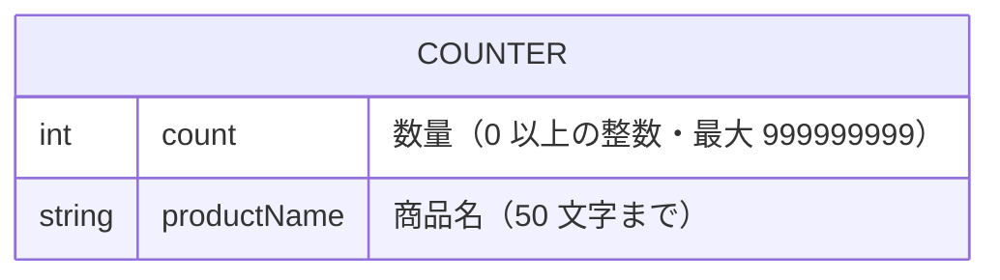

# データ設計（ER 図）

[要件定義書](requirements.md) の「保持（F5）」の詳細。

このアプリには DB（データベース）がない。保存するのは、使っている端末のブラウザの中（localStorage）に、
**カウンター 1 つ分のデータだけ**。そのため、ER 図は「カウンター」の 1 つの箱だけになり、ほかのデータとの線（関係）はない。

## ER 図


GitHub 上では上の図が表示される。表示されない場合は、次の図で見る。

```
┌─────────────── COUNTER（カウンター）────────────────┐
│ count        数量   0 以上の整数（最大 999999999）     │
│ productName  商品名 文字（50 文字まで）               │
└────────────────────────────────────────────┘
```

## 保存のしくみ
| localStorage のキー | 中身 | 最初の値 |
|---|---|---|
| `counter.count` | 数量 | 0 |
| `counter.productName` | 商品名 | 空 |

- 値が変わるたびに、自動で保存する。画面を開くときに読み込む。
- 保存された値が壊れていた場合（整数でない、範囲外など）は、数量を 0 として扱う。
- 保存できない環境（プライベートモードなど）でも、画面は動く。ただし閉じると消える。

## 今回は持たないデータ
履歴・日付・担当者・複数の商品は持たない（[要件定義書](requirements.md) の「対象外」を参照）。
